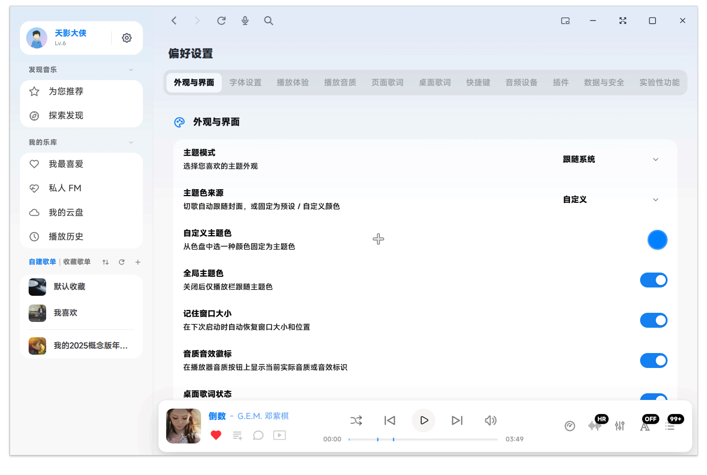

# Echo Miuix

将 EchoMusic 的界面改为 MIUIX (小米澎湃) 风格。
[EchoMusic](https://github.com/hoowhoami/EchoMusic)



## 兼容性

需要 EchoMusic `>= 2.2.6-beta.9`。

## 结构

皮肤按 Miuix 的语义分层重写，改样式时按层找，不要跨层改：

```
style.css
  §0  设计 token       颜色角色 / 形状 / 字号 / 动效 / 阴影 / 层级
  §1  宿主变量映射     把 Miuix 角色接到 Echo 的 --surface-* / --text-* 等语义变量
  §2  门控与全局       html.miuix-theme-active、滚动条、选区
  §3  布局外壳         侧栏 / 主内容 / 播放栏 / 底部渐隐 / 页面留白
  §4  侧栏             §5 设置页   §6 卡片   §7 列表   §8 控件   §9 Tab
  §10 浮层             §11 播放栏与迷你窗   §12 歌词页   §13 辅助
  §14 次级面板与动作   §15 动效   §16 交互层（JS 驱动的状态类）
```

约定：

- 只在 `html.miuix-theme-active` 下生效；`index.js` 同时切换 manifest style 的 media。
- 状态色走 `--mx-hover / --mx-pressed / --mx-selected`，形状走 `--mx-r-*`，不要手写 alpha 与魔法圆角。
- 浮层默认不透明；只有用户开启「浮层毛玻璃」时才跟随宿主做半透明 + blur。
- 全文件只有 1 处功能性 `!important`（透明窗），其余靠层级解决。

`index.js` 分四段：门控 / 主题注册 / 交互效果注册表 / 设置面板。每个效果是
`() => cleanup` 的工厂，统一由 `activate()` 交给 `ctx.dispose` 回收；DOM 重挂载
由单个 `MutationObserver` + rAF 节流统一驱动，不再每个效果各开一个 observer。
